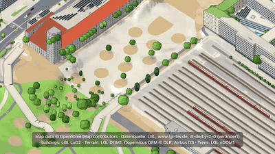
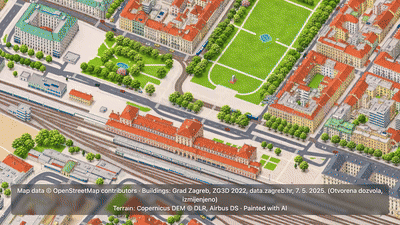
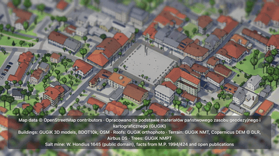

# Isometric World

Isometric maps of real cities, built from open data. Everything is TypeScript.

[](https://isometricworld.dmytrokrasun.com/tel-aviv-yafo)

First city: **[Tel Aviv-Yafo](https://isometricworld.dmytrokrasun.com/tel-aviv-yafo)** (`/tel-aviv-yafo` on the dev server), from Jaffa to Yarkon Park and
Ramat Gan, including the sea, painted with AI (OpenAI's image model through the Codex CLI). Full-quality clip: [`video/tel-aviv-yafo.mp4`](video/tel-aviv-yafo.mp4).

[](https://isometricworld.dmytrokrasun.com/stuttgart)

Second city: **[Stuttgart](https://isometricworld.dmytrokrasun.com/stuttgart)** (`/stuttgart`), by [Lukas Hermann](https://lukashermann.dev/): the city and the towns
around it from LGL Baden-Württemberg open data, drawn procedurally instead of painted. Full-quality clip:
[`video/stuttgart.mp4`](video/stuttgart.mp4).

[](https://isometricworld.dmytrokrasun.com/zagreb)

Third city: **[Zagreb](https://isometricworld.dmytrokrasun.com/zagreb)** (`/zagreb`), by [Andrej Šimunaj](https://zeropointstudio.io): the whole city (its 17
districts) from the City of Zagreb's ZG3D LoD2 model, with urban Zagreb painted with AI (OpenAI's and Google's image models through fal.ai). Also on Andrej's
site, [zagreb.zeropointstudio.io](https://zagreb.zeropointstudio.io). Full-quality clip:
[`video/zagreb.mp4`](video/zagreb.mp4).

[](https://isometricworld.dmytrokrasun.com/wieliczka)

Fourth city: **[Wieliczka](https://isometricworld.dmytrokrasun.com/wieliczka)** (`/wieliczka`), by [Maciek Chmura](https://maciek.cloud/): the town near Kraków from
GUGiK, Poland's national open geodata, drawn procedurally instead of painted, with its salt mine's levels under
the town and a biplane to fly over it. Full-quality clip: [`video/wieliczka.mp4`](video/wieliczka.mp4).
Map data © OpenStreetMap contributors · Opracowano na podstawie materiałów państwowego zasobu geodezyjnego i
kartograficznego (GUGiK, CC BY 4.0) · Terrain: GUGiK NMT, Copernicus DEM © DLR, Airbus DS · Salt mine: plan by
W. Hondius, 1645 (public domain).

## The idea

Real cities as an isometric illustration, painted with AI, that you can pan and zoom like a map, with every building,
street and tree where it really is, and a little life on top (cars, buses, cats, parakeets, an airliner).

1. **Geometry from open data**: buildings and trees (municipal GIS, OpenStreetMap), streets, parks,
   coastline (OpenStreetMap), terrain (Copernicus DEM). No Google or other proprietary map content.
2. **One orthographic camera per region** (45° tilt, 0.25 m/px) renders it as a plain 3D model with three.js.
3. **An image model repaints every window** of that render in one illustrated style, checked against the
   render so nothing moves.
4. **A deep-zoom web viewer** (Astro + OpenSeadragon) streams the painted tiles from Cloudflare R2 and draws
   the simulated traffic on top.

## Quick start

Needs Node 24+, Chromium (or Chrome: set `CHROME_PATH`), and for the optional steps FFmpeg (clips), gifsicle (GIF), the Codex CLI
(painting; or a fal.ai key, see `.env.example`) and a Cloudflare account with wrangler (publishing).

```sh
npm install
npm run dev        # open http://localhost:<port>/tel-aviv-yafo (port printed by the dev server): the published map, from R2
```

Building the map yourself starts at **Pipeline** below; no API keys are needed except your own Cloudflare
login for publishing (`.env.example`).

**Adding a city** (for people and coding agents): see [AGENTS.md](AGENTS.md): what to research, which open
datasets and licences are acceptable, code changes, pipeline commands and checks. Sources and credit lines:
[ATTRIBUTION.md](ATTRIBUTION.md).

## Regions and cities

`pipeline/src/places.ts` is the one table of places, shared by the pipeline and the site.

- A **region** is one flat map: one orthographic camera in a local East-North-Up frame at the region's
  origin, one tile pyramid under `regions/<region>/` on R2 (see Hosting). A flat map stays accurate (~1° of building lean
  at 100 km) for every city within ~150 km of its origin, so they share it and you scroll between them.
  Far-apart cities get their own region (a world overview linking regions can come later).
- A **city** is a named view into a region. `/<city>` (e.g. `/tel-aviv-yafo`) opens the region centred on it;
  `/` opens the default city. Links with capitals (`/Tel-Aviv-Yafo`) redirect to the lowercase one (404 page).
- An **area** (`pipeline/src/areas.ts`) is a bbox the pipeline renders and paints; it belongs to a region,
  and every step switches to that region's camera (`openArea` → `useRegion`).

Links: `/tel-aviv-yafo?at=32.054,34.752,1` (lat, lon, screen width in km), `#@x,y,zoom` (kept in the URL
while you pan), `#metro` (whole region).

## Hosting

**Site:** Cloudflare Workers static assets (`wrangler.jsonc`).
Build `npm run build`, deploy `npm run deploy` (builds, then `wrangler deploy` on `SITE_DOMAIN` from `.env`).
Only the built pages go there.

**Analytics:** Pirsch (cookie-free), proxied first-party by the site's Worker (`worker/index.ts`, only
`/p/*`; snippet in `web/src/components/MapPage.astro`, production builds only). Set the access key once
(Pirsch → Settings → Integration → Add Client, type "Access Key"): `npx wrangler secret put PIRSCH_ACCESS_KEY`.

### Map data (R2)

Map data is not in git or `web/public`. It lives in the R2 bucket `isometricworldtiles` (Cloudflare account
`CLOUDFLARE_ACCOUNT_ID`), served under `regions/<region>/` from its public origin `TILES_ORIGIN` (`.env`,
see `.env.example`; read by `pipeline/src/hosting.ts`).

```
data/derived/<area>/{render,paint,height}   sources (local; archived in isometricworld-archive, see Archive)
        │ npm run export -- <areas>          only tiles whose source changed (state: data/web-state/<region>.json)
        ▼
data/web/regions/<region>/                  local cache = unpublished changes
        │ npm run dev                        dev server serves the cache, redirects everything else to R2
        │ npm run publish -- <region>        upload (asks [y/N]) with the state, check, record it, empty the cache
        ▼
R2 isometricworldtiles/regions/<region>/    production (dev and deployed builds read it)
        │ npm run deploy                     rebuild the site: pages pick up the new file names and previews
```

- **Deploy after every publish.** Each page is built with the published `world.json`: it preloads the
  content-hashed files named there and shows the city preview from it. Without a redeploy the site still
  works (the viewer reads the live `world.json`), but the preloads miss and the preview shows the old view.

- Everything but `data/world.json` is cached for a year (`immutable`): tile URLs carry `?v=<content hash>`
  from `tiles-<layer>.<hash>.json`, and the data files and city previews have their hash in the name, so a
  re-painted tile or a new export gets new URLs. `world.json` (60 s) names the current files; the page
  preloads the ones its build saw. Tiles are AVIF only. Tel Aviv keeps its last WebP pyramid (`tiles.json`,
  `.webp`) as a legacy fallback for browsers without AVIF; newer regions (Stuttgart, Zagreb) have none and need
  none (AVIF: Safari 16+, every current browser).
- Export works without the cache: lower zoom levels that need an unchanged neighbour fetch it from R2.
  Exports stack until you publish (`data/web/<region>.state.json`); deleting `data/web/` drops unpublished
  work and nothing else.
- The published state (every tile's source stamp and content hash) is kept locally in
  `data/web-state/<region>.json` and on R2 as `regions/<region>/state.json` (`pipeline/src/webstate.ts`):
  publish uploads it before `world.json`, and export downloads it when this machine has none, so another
  maintainer (or a copy of the region's folder from another bucket) picks up where the last publish left off.
  publish refuses when R2's state changed since the export started (someone else published): export again.
  A region published before this: `npm run publish -- <region> --state-only` uploads its local state. Without
  any state, the next export rebuilds everything.
- Publish uses R2's S3 API with `R2_ACCESS_KEY_ID` + `R2_SECRET_ACCESS_KEY` (the only way a token scoped to one
  bucket works), else the Cloudflare API with `CLOUDFLARE_API_TOKEN` or the wrangler login (`npx wrangler login`).
  The Cloudflare API allows ~4 uploads/s: a whole region (~9k files) takes ~40 min once (the S3 API is faster);
  later publishes carry only changes.
  `--keep` leaves the cache in place, `--yes` skips the question.
- The bucket is public, read-only (CORS: any origin, GET/HEAD), so a production build works from any host or
  local port. In dev, `/regions/*` goes through the dev server: the local cache first, then proxied from R2.

### Archive (R2)

The pipeline's own files (`data/derived/`: renders, height passes, painted windows and tiles; `data/raw/`:
fetched sources) are archived in a second, private bucket, `isometricworld-archive` (Infrequent Access,
`pipeline/src/archive.ts`). No machine is then the only copy of the paintings, and a later repaint downloads
and uploads only the part it touches.

```sh
npm run archive -- <region>          # upload what is new or changed (all areas of the region); `shared`: the rest of data/raw
npm run archive -- <region> --verify # every entry is in the bucket with its size; 40 random files downloaded and hashed
npm run pull -- <region> shared      # the small files: manifests, ground, height passes, scene, raw sources, paint.json…
npm run pull -- <region> --near <lat>,<lon> --radius 1   # + renders, paintings and windows of a patch
npm run pull -- <region> --all       # everything (--history adds windows-replaced/, paint-withdrawn/, work/)
npm run archive -- --tar <url> --sha256 <hex>   # stream a contributor's tar of data/… into the archive, no local copy
```

- Content-addressed: `objects/<sha256>` holds each distinct file once (windows shared between areas, hard links),
  `manifests/<region>.json` maps every path under `data/` to `[sha256, size, mtime]`, and each upload leaves a
  dated copy in `manifests/<region>/`. Nothing is overwritten or deleted: a repainted window is a new object.
- `pull` hash-checks every file, restores mtimes (paint and export compare them), links identical files instead
  of downloading them twice, and never replaces a local file that differs from the archive (`--force` does).
- **Repainting a few buildings** on a machine without the region:
  ```sh
  npm run pull -- zagreb shared --near 45.81,15.977 --radius 1   # the patch: the windows paint --near repaints, their neighbours, every window under their tiles
  npm run paint -- zagreb-core --near 45.81,15.977 --radius 1
  npm run export -- zagreb --partial    # re-encodes only the tiles whose render/painting is here; the rest stays as published
  npm run publish -- zagreb             # only the changed tiles
  npm run archive -- zagreb             # only the new windows and paintings
  ```
  `--partial` still builds roads, trains and bridge decks for the whole region, from the small files `pull`
  brings (`raw/<area>/roads.json`, `ground/`, `height/`). A region with only tiles in the archive (Zagreb's
  backup had no `raw/` and `ground/`) needs `npm run fetch` and `npm run ground` for each area first.
- Same auth as publish; with an R2 access key (`R2_ACCESS_KEY_ID`) it runs 16 at a time instead of ~4 files/s.
  `ARCHIVE_BUCKET` points it elsewhere.

### Contributing a city

Contributors never publish to the production bucket. The code goes in as a pull request; the tiles go to a
bucket for review, and the maintainers copy them into production after merging.

1. **Pull request** with the code (`places.ts`, `areas.ts`, sources, `ATTRIBUTION.md`, credits), as in
   AGENTS.md "Adding a city". A new region gets a new `regions/<region>/` name; never publish to an existing one.
2. **Publish the region to a review bucket**, either:
   - **your own R2 bucket** (public access on, through r2.dev or a custom domain), or
   - **a temporary bucket from us**: ask in the pull request. You get the bucket name, its public URL, the
     account ID and an R2 token that can only write to that bucket and expires.

   Then, in your `.env`:
   ```sh
   TILES_BUCKET=<bucket>            # never isometricworldtiles
   TILES_JURISDICTION=eu            # only if the bucket was created in a jurisdiction
   TILES_ORIGIN=<its public URL>
   CLOUDFLARE_ACCOUNT_ID=<the bucket's account>
   R2_ACCESS_KEY_ID=<access key of an R2 token with Object Read & Write on that bucket>
   R2_SECRET_ACCESS_KEY=<its secret access key>
   ```
   and run `npm run export -- <areas>` and `npm run publish -- <region>` as usual. Publish uploads
   everything under `regions/<region>/`: tiles, previews, data files, `state.json` (the published state: keep
   it, it lets anyone continue from your export) and `world.json` last. Nothing else goes in the bucket.
3. **Tell us in the pull request**: the bucket, its public URL, the file count and size, and (your own bucket)
   a read-only R2 token for it (Object Read on that bucket), for the copy.
4. **Review** (maintainers): `TILES_ORIGIN=<review URL> npm run dev` shows the region from the review bucket;
   check the city page, borders, traffic, credits, no console errors.
5. **Merge and copy** (maintainers): merge the pull request, then copy `regions/<region>/` into production
   (Cloudflare R2 → Data Migration, or rclone) so the keys stay `regions/<region>/…` and the content type and
   cache headers are kept, `world.json` last. Check every file `world.json` names against its content hash,
   that `state.json` arrived, then `npm run deploy`. Delete the temporary bucket and its token afterwards.

## Pipeline

```sh
npm install

npm run fetch -- tlv-core              # municipal + OSM buildings, canopy, OSM ground, Copernicus DEM
npm run ground -- tlv-core             # terrain grid + OSM ground features (ENU)
npm run scene -- tlv-core              # 3D buildings + trees (ENU) binned by render tile
npm run render -- tlv-core -j 2        # open-data scene -> one ortho camera -> tiles (~0.2 s/tile)
npm run paint -- tlv-core --near 32.064,34.775 --radius 2   # Codex repaint (optional, slow)
npm run export -- rothschild tlv-core  # changed web tiles + data into the local cache (all areas of one region)
npm run dev                            # preview: local cache over production tiles
npm run publish -- israel-center       # upload the cache to R2 (asks first), then empty it
npm run dev                            # Astro + OpenSeadragon viewer
pipeline/watch-export.sh &             # re-export every 20 min while painting (preview in dev; publish when happy)

# tests and clips (against a running site; the URL argument can be left out when SITE_URL is set in .env)
npm -w pipeline exec tsx src/uitest.ts http://localhost:<port>/   # wheel/drag/keys, errors, screenshots
npm -w pipeline exec tsx src/perf.ts   http://localhost:<port>/   # bytes & time per zoom step
npm -w pipeline exec tsx src/tour.ts   http://localhost:<port>/ tour   # screenshots of known places
npm -w pipeline exec tsx src/traffictest.ts http://localhost:<port>/ 5     # 5 sim-minutes: overlaps, speeds, jams
npm -w pipeline exec tsx src/film.ts http://localhost:<port>/ ../video/tel-aviv-yafo.mp4  # 14 s 1080² 60 fps clip for X (--preview: quick 6 fps check; --blur 8: motion blur)
npm -w pipeline exec tsx src/film.ts http://localhost:<port>/ ../video/stuttgart.mp4 --city stuttgart --seconds 4.5  # shots per city: FILMS in film.ts
npm -w pipeline exec tsx src/film.ts http://localhost:<port>/ ../video/zagreb.mp4 --city zagreb --film zagreb-readme --seconds 12  # --film: another shot list
npm -w pipeline exec tsx src/film.ts http://localhost:<port>/ ../video/wieliczka.mp4 --city wieliczka --seconds 12
npm -w pipeline exec tsx src/beforeafter.ts before.mp4 after.mp4 ../video/stuttgart-before-after.mp4 --holds 0,7.35,19  # wipe: production vs dev cache (--film stuttgart-before-after; steps in beforeafter.ts)
```

**Fixing a few buildings** (local rebuild, review, publish only them):

```sh
npm run scene -- tlv-core --parts 20         # swap the top 20 (osm-parts.json lists them, with their pixel boxes)
npm run render -- tlv-core --parts           # just the render tiles under them
npm run paint -- tlv-core --parts            # repaint only the windows over them; only their art tiles are
                                             # rebuilt, with the saved sea colour (paint.json seaRef)
npm run export -- rothschild tlv-core --parts  # only tiles around them into the cache; the rest stays as published
npm run dev                                  # review: the cache over production
npm run publish -- israel-center             # uploads just that cache
```

A plain export also leaves out tiles whose encoded bytes equal the published ones, but after pipeline changes
most tiles differ slightly, so `--parts` is what keeps a fix small.

| Step | File | What it does |
|---|---|---|
| camera | `pipeline/src/camera.ts` | One orthographic camera per region, tilted 45° down, 0.25 m/px, in a local ENU frame at the region origin (Israel Center: Dizengoff Square, heading 340°). The same math drives both the renderer and the border projection, so they align exactly. |
| fetch / scene | `pipeline/src/fetch.ts`, `scene.ts` | Buildings come from Tel Aviv-Yafo GIS (footprints + 2019 surveyed heights) and OSM elsewhere, and trees from the 2024 canopy layer, all extruded in our renderer. The municipal layer has one height per footprint (a podium can carry its tower's height: the Azrieli mall stood at 187 m), so the N municipal buildings OSM's 3D shapes (Simple 3D Buildings: `building:part`, heights) change most are swapped for those shapes (`scene -- tlv-core --parts N`, default 10; listed in `data/derived/<area>/osm-parts.json`). See "Fixing a few buildings" below. |
| ground | `pipeline/src/ground.ts`, `pipeline/page/ground.ts` | Terrain from Copernicus GLO-30 (a surface model: buildings removed with a morphological opening + blur), sea from the OSM coastline. The surface is drawn per tile from OSM onto a canvas texture draped on the terrain: landuse, parks, beach, water, pavements, roads at real widths (`roadspec.ts`, shared with traffic) with lane markings kept out of junctions, flat road ends with junction disks (no bulges at bridge ends), rail drawn in its layer (under road bridges), zebra crossings, paths, rail, soft contact shadows. Bridges/decks the municipal layer records as buildings (anything a motorway or railway runs through) are dropped in `scene.ts`. |
| render | `pipeline/src/render.ts`, `pipeline/page/renderer.ts` | Headless Chrome (Playwright) + three.js. Buildings sit on the terrain grid and get window-grid facades; tree crowns are instanced. Each tile gets a color pass and a height pass. No network access, no API keys. |
| paint | `pipeline/src/paint.ts` | Codex CLI image generation (ChatGPT login, no API key). Each window gets four images: the render, the height map, the style reference (`pipeline/style/reference.png`) and the tree species sheet (`pipeline/style/trees.png`: ficus, tipuana, jacaranda, flame tree, olive, Aleppo pine, eucalyptus, date and fan palms; the render colour-codes each crown's species, mostly one species per ~40 m patch). Windows are 1024 px with stride 896, painted in rings from the centre; each continues its painted neighbours. With `PAINT_BACKEND=fal` (`FAL_KEY`) the windows go to an image model on fal.ai instead, many at once (`-j`), each call's billed cost logged to `paint-spend.jsonl` and capped by `PAINT_BUDGET_USD`. Open sea reuses one validated sea texture. Any window with a black band or patch is repainted, and every restart re-checks finished windows. Negative window numbers need `--window=-7,4`. To fix something on a seam, delete the neighbour sharing it first (each window copies its painted neighbours' edge strips, so a repaint would copy the old mistake back). When tiles are assembled, deep water in every window is shifted to the median deep-sea colour, fading in from the coast, so the sea has no window-sized patches. `--older=<ISO time>` repaints windows painted before that time (after a style change) alongside a normal run. `--assemble` only rebuilds the art tiles. |
| export | `pipeline/src/export.ts` | Builds the `map` layer (paints, renders where unpainted) and the `photo` layer (renders) as an AVIF pyramid, only the tiles whose source changed since the published state, into the local cache. Every tile's content hash goes into `tiles-<layer>.<hash>.json` (the viewer requests `?v=<hash>`). Each city's opening view is saved as a small preview image (`preview/`), shown until the tiles are in. Roads go out columnar and delta-coded. OSM borders are projected onto the real terrain height from the height pass. OSM road bridges (layer > 0) are drawn over the painted tiles in the painted road style, so a bridge deck always lies on top of any rails or lanes Codex drew across it. |
| publish | `pipeline/src/publish.ts` | Uploads the cache to the R2 bucket (tiles and previews first, `world.json` last), checks every upload, records the published state, empties the cache. |
| web | `web/src/scripts/map.ts`, `traffic.ts`, `cats.ts`, `sky.ts` | OpenSeadragon deep zoom: a sparse pyramid with a tile index (no 404s), level blending, and zoom limited to the metro. A canvas overlay draws borders, labels, and simulated cars and buses on OSM roads (split at every shared node): lanes within the drawn asphalt, car following with safe gaps, junctions taken in turns by approach, drifting cruise speeds; hidden behind buildings using the height pass and under bridges (higher OSM layer). A few street cats (~1 per 900 m of street) sit and stroll on the pavements when zoomed in close; small flocks of green parakeets dart over the streets, and every ~2 min an airliner comes in from the sea on the Ben Gurion approach and fades out inland. Regions can opt into more life (`life` in `places.ts`): detailed vehicles (body and cabin with windows and lights, vans, buses with their window band, shadows cast like the styled render's), coach parks of a tourist site (rows of parked coaches as on the orthophoto, coaches driving to and from them along the road graph by Dijkstra distances; `traffic.ts`), and pigeons on a square (walking, pecking, taking off as a flock; `pigeons.ts`). With `life.foreground` the render also writes a mask of what stands higher than a car (crowns, walls and roofs over ~2.5 m); export cuts those pixels out of the render as the `fg` tile layer (transparent elsewhere, z5–8), and the viewer draws it back over the vehicles where they are (`foreground.ts`), so they pass under trees and behind houses partly covered instead of fading out. Regions can opt into viewer effects (`effects` in `places.ts`): a biplane to fly over the map (`fly.ts`: arrows or WASD bank it into turns and change its speed, a finger or the mouse held on the map steers it there, the map follows; a 3D model built in `biplane.ts` with three.js, loaded at the first take-off, seen through the map's camera and lit by its sun, an object of the map at 2.5× life size flying 45 m up, smoke puffs behind; its shadow lies over roofs, walls and crowns, read from the render's height pass, which export writes as `tiles/height/` for regions with a biplane, `heights.ts`). Round buttons in the top right corner, one under the other, switch them. More effects: cloud shadows drifting over the map (`clouds.ts`), and a search box finding streets and places by name with `/` (`search.ts`; export writes `data/search`: named roads and the named places of the region's OSM extract). Keys: **B** borders · **T** traffic · **P** raw render · **I** about · **V** video mode (`?video`) · **F** fly (Esc lands). `/#metro` shows the whole metro. |

**Stuttgart** (region `stuttgart`, `sources: "lgl"`, `look: "styled"`) differs from Tel Aviv:

- Data: LGL Baden-Württemberg open data (dl-de/by-2.0, `lgl.ts`): LoD2 buildings with real roofs (`lod2.ts`),
  DGM1 bare-earth terrain, and tree crowns found in the nDOM1 surface model (`canopy.ts`).
- OSM comes from a Geofabrik extract via osmium (`osmExtract`, `osmlocal.ts`; `brew install osmium-tool`),
  not from Overpass.
- Look: not painted (`look: "styled"`, independent of `sources`). The renderer draws a styled look itself
  (facade and roof materials, hillshade, outlines, ambient occlusion, paper grain; `STYLED` in `renderer.ts`).
  Variants of it are presets in `pipeline/src/styles.ts` (`style`; Stuttgart uses the default "stuttgart"):
  cast sun shadows, wall palettes per building style, and `monumental` walls for chosen building kinds
  (churches in "poland": laid out on each LoD2 wall from its own extent, not a floor grid: pilasters, one tall
  arched window per bay, cornice, oculus and portal in the gable, towers in storeys with a clock and belfry).
  Where the source says what a building is used for and how many storeys it has (GUGiK: BDOT10k), its walls
  follow that rather than chance: window rows by storeys, shop fronts where there is a shop, loggias on blocks
  of flats, garage, shed and hall doors, a market's panels, sign band and entrance (`facadeFlags` in
  `scene.ts`, `wallFacts` in `renderer.ts`); a measured roof colour is never replaced by a made-up green roof.
  `eaves` (on in "poland"): LoD2 roofs end flush with the walls, so each pitched roof plane is carried past its
  eaves (≈ 0.5 m) and gables (≈ 0.3 m), with a gutter under the eaves and downpipes at their ends and corners.
  `trunks`: broadleaf crowns stand on a trunk. `streetDetail`: pavements only where OSM's `sidewalk*` tags put
  them, separately mapped sidewalks drawn as kerbed pavement, and road and path surfaces (paving, setts,
  gravel, dirt, grass, concrete) from OSM `surface` (`ground.ts`, `page/ground.ts`). `lawns`: lawns and
  gardens where the orthophoto is green, traced as smooth outlines over plain residential land (`lawns.ts`),
  and a grass texture fixed to the map on lawns, parks, meadows and the like. `richTrees` (`page/trees.ts`):
  crowns of several lobes in a few variants, a Central European species mix with its own shapes, colours and
  bark (limes, oaks, birches, fruit trees, poplars, willows, tiered spruces, umbrella pines, thujas), and
  foliage shading (clumps of leaves, a darker underside); each keeps the top the surface model measured.
  `bushes`: bushes and hedges from the surface model 0.7–3.5 m above the ground where the orthophoto is green,
  away from buildings and taller vegetation (`gugik.ts` bushes), drawn as lobed bushes and thujas.
  `bridgeDetail`: OSM bridges often end short of their abutments, over the gap the terrain model leaves under
  them; each abutment end is carried on to where the embankment tops out (`ground.ts`; `deckHeight` takes the
  extensions, so traffic drives on the drawn deck), decks are as wide as the road plus a cornice, with 3D
  parapets, and piers stand under high spans, off the roads and rails below (`renderer.ts` buildDecks).
  `powerLines`: OSM high-voltage lines (`fetch.ts` osm-power.json) built as lattice pylons (or tapered poles) at
  their towers, arms across the line by circuits, conductors and an earth wire sagging between them; heights
  from OSM or the voltage, since the surface model does not see a lattice (`power.ts`). `playgrounds`: the
  equipment OSM maps on playgrounds as small bright models, on public playgrounds without any a set by their
  size (sandpit, swing, tower with a slide, seesaw, spring riders, roundabout), rubber safety pads under it and
  sandpits on the ground (`playgrounds.ts`). `waterDetail`: water with lighter shallows along the shore, a muddy
  bank, ripples and sun glints fixed to the map, murky treatment basins, dry detention and retention reservoirs
  (`intermittent=yes`) as the grassy basin they are most of the time, and the rivers, streams, ditches and
  drains OSM maps as lines (`fetch.ts` osm-water.json, culverts left out). `parkedCars`: cars on the parking
  lots and bays OSM maps, about two thirds occupied: on its stalls where mapped, else laid out by the lot's shape
  (a kerbside lane, a row, or rows between aisles), with stall lines on lots (`parking.ts`). `barriers`: OSM
  fences (see-through: posts and rails), walls, noise barriers, retaining walls and guard rails on the terrain,
  hedges as rows of bushes (`barriers.ts`). `streetLamps`: OSM street lamps with an arm over the nearest road;
  `roofsOnPosts`: building=roof and carport outlines (fuel canopies, carports, shelters) as slabs on posts at the
  surface model's height (`props.ts`). `streetFurniture`: bus shelters open to the road (a blue stop sign where
  there is none), benches, waste baskets, flagpoles with a Polish or EU flag, advertising columns and
  billboards, wayside shrines and crosses, memorial stones, traffic signals on both sides of the road (`props.ts`).
  `closedLines`: roads and paths mapped as one closed way (roundabouts, loops round a car park or a lawn) are
  simplified as rings; the line simplification collapsed them to nothing (on in both presets; Zagreb, on the default
  preset, keeps its published tiles until re-rendered). `roofDetail`: clay roofs in courses of staggered tiles, each tile its own
  shade, grey sheet roofs with standing seams down the slope, brick or plaster chimneys rising past the ridge of
  homes' pitched roofs. `ink`: how strong the post pass's outlines are and from which depth crease, and how dark
  its ambient occlusion makes a corner ("poland": crisper lines and deeper corners than "stuttgart"). `repaint` (on in "stuttgart"):
  what AI repaints of the render taught, drawn by the renderer: green gardens and parks, one dark asphalt with an
  ink kerb line, kerb shadows, bold markings and rounded inside corners, ponds with a shore path, runways with
  piano keys, designators and lights, mown grass strips, tracks on shared gravel beds with bold rails, rail yards
  and platforms (`page/ground.ts`); bigger two-casement windows with stone surrounds and storey cornices, darker
  bark and, without `trunks`, crowns stretched into ovals over a short trunk (`renderer.ts`).
- Painting from aerial photos (the Stadtbibliothek / Europaviertel patch, windows 4..6 × -1..1 of `stuttgart-core`):
  1. `npx tsx src/aerial.ts <area> --near <lat>,<lon> --radius <r> --source city` drapes the city's 2023
     orthophotos (CC BY 4.0, cached in `data/raw/aerial/`) onto the render's view: every non-wall pixel gets the
     photo colour of the ground point it shows (camera inverted at the height-pass height); walls stay grey 128.
     Writes `data/derived/<area>/aerial-city/`. `--source lgl` (LGL DOP20) is newer but hazier.
  2. `npm run paint -- <area> --near <lat>,<lon> --radius <r> --center <lat>,<lon> --aerial city --aerial-input`
     bakes the photo into image 1 (walls from the render, roofs/ground/trees from the photo) and tells Codex to
     keep its real colours and materials. Attaching the photo as an extra image instead (`--aerial` alone) was
     tried and ignored by the model.
  3. Photos can't show facades: add landmarks to `FACADES` in `paint.ts` (name, lat/lon, facade text); a note is
     added to the prompt for every window it falls in. Without one the model guesses (the library came out beige).
  4. QA: hybrid paintings follow the photo, not the render, so they match it less (0.41–0.61 when right);
     the repaint threshold is 0.35 in this mode instead of 0.45.
  5. Partly covered tiles at the patch edge fade from the paint into the render (64 px), so a patch needs no
     full-tile alignment. Export as usual (all areas of the region).
  - `--tag <name>` sends windows/work/paint to `<dir>-<name>` folders that export never reads: use it for experiments.
  - Known gaps: the photo (2023) and LoD2 disagree in places; the photo wins on surfaces, so render-only details
    (pools, some trees) disappear, and a building newer than LoD2 shows as a flat roof texture. ~2–5 min per window.
  - `--look simple` (being tested at the airport) uses `style/reference-simple.png` (a crop of the styled render)
    as the style reference, median-flattens the photo instead of boosting it (no CLAHE), and asks for flat
    surfaces, low-poly trees and no aircraft or vehicles (the map animates both). Why: in the default look,
    close up the painted tiles look washed out and noisy next to the render, and zoomed out the detail turns to
    mush; painted AVIF tiles are ~1.9× the bytes of rendered ones (z8: 43 KB vs 23 KB).
  - Windows are colour-matched before assembly (one RGB offset per window, least squares over the overlap
    strips), then joined along a seam cut: per neighbour pair, the cheapest path (least colour difference)
    through the overlap band, feathered over 8 px. In every region (the old fixed cross-fade ghosted streets and
    trees where two windows disagreed; tiles assembled before keep it until re-assembled). The cut does not fix a seam inside a window
    where a pasted neighbour strip ends and the model painted a different material.
  - Map mask: `aerial.ts` also writes `mask/<tx>_<ty>.png` (white = keep the render): streets (+ kerbs),
    rails, squares, paving, water and bridge decks from `ground/features.json`, rasterised at 0.25 m and
    applied only where the surface is within 2.5 m of the terrain (or on a bridge deck). The hybrid input
    keeps the render there instead of the photo, and the prompt treats those flat shapes as exact geometry, so
    the model keeps streets, tunnel mouths, turning loops, fountains and rail where the map has them.
  - Building uses: `pois.ts` cuts OSM amenity/shop/tourism/leisure features (fast food with brand, fuel,
    churches, stations, car parks, schools, …) from the extract into `data/raw/<area>/pois.json` (delete it to
    re-cut). Up to 12 per window go into the prompt with their pixel position, most distinctive first.
  - `--near`/`--center`/`aerial.ts` find the window via `groundPixel` (height pass), so high ground (the
    airport, ~440 m) lands on the right window.
  - Known misreads in the library patch: Mailänder Platz (pedestrian square, fountains) came out as a street,
    because the photo's sun shadow plus the grey wall fill look like asphalt (the photo is not a true ortho;
    buildings lean). The Wolframstraße underpass under the rail bridge shows cars and no portal:
    `hideUnderBridges` (export.ts) only checks road under road, and `portals.ts` only handles tunnel-tagged ways.
- Shape: the region's `outline` (`outline.ts`) is the union of OSM boundary relations (Stuttgart, 62375, and
  the bordering towns) plus a box around the airport. Only LGL cells and tiles touching it are fetched and
  rendered, and export fades the map edge along its outer border only (not between the towns).
- OSM detail on top of LoD2: `roof:colour`/`roof:material` and `building:colour`/`building:material` set roof
  and facade looks; tall towers (`man_made=tower|communications_tower`, ≥ 60 m) are rebuilt from their OSM
  `building:part`s; no nDOM tree crowns on railway and construction land.
- Landmarks (`landmarks.ts`: the registries and how they are matched; the models per region in `landmarks/`):
  hand-built models from published dimensions, matched by OSM `name`: the Fernsehturm (whole tower) and the
  Mercedes star on the Bahnhofsturm (on its roof). `STRUCTURES` builds tagged structures from their OSM outline
  in every region (graduation towers); `PLACED` puts a model at a measured point (Wieliczka's viewing tower).
- Areas: the city (`stuttgart-*`) and the towns around it (`metro-*`) are split into overlapping areas. Where
  they overlap, export takes each tile from the area it lies deepest inside.

**Wieliczka** (region `wieliczka`, `sources: "gugik"`, `look: "styled"`, `style: "poland"`) differs again:

- Data: GUGiK, Poland's national open geodata (CC BY 4.0; the 3D models CC0), read per powiat (`teryt`) in
  PUWG 1992 (`gugik.ts`, built on Piotr Kulpiński's Kraków branch): the 3D building models (LoD2 with roofs from
  the 2017 airborne LiDAR, LoD1 2024 for newer buildings), BDOT10k for what each building is used for (it picks
  the look and the façade's storeys, shops and doors), the buildings the models lack from BDOT10k and OSM
  outlines with roofs fitted to the surface model (`fitroof.ts`), NMT 1 m terrain (Copernicus outside its
  sheets), tree crowns from NMPT − NMT, and the orthophoto (WMS, 0.25 m) read for each roof's roofing, the
  lawns and gardens (`lawns.ts`) and which crowns have foliage. No pixel of the photo is shown.
- OSM from the Geofabrik Małopolska extract via osmium, as in Stuttgart.
- Look: styled, preset "poland" (`styles.ts`; the features above).
- Shape: the gmina and Kraków (`outline`), cut further by the areas: the town and the A4 stay clear of the
  faded edge.
- Viewer (`effects`, `life`): a biplane to fly (F; its shadow laid over roofs from the exported
  height pass), cloud shadows, a search box (export writes the index), detailed vehicles, coaches to the salt
  mine's coach parks, pigeons on Rynek Górny, and a foreground layer so vehicles pass under trees and behind houses.
- Areas: `wieliczka-rynek` (a test patch: the Rynek, the castle, the shafts), `wieliczka-town` (the town and a
  ~650 m ring) and the mine's levels below.

```sh
npm -w pipeline run boundaries -- wieliczka
npm run fetch -- wieliczka-town               # GUGiK models, BDOT10k, NMT/NMPT sheets, orthophoto; OSM from the extract
npm run ground -- wieliczka-town && npm run scene -- wieliczka-town
npm run render -- wieliczka-town -j 2         # ~35 min
npm run export -- wieliczka-town
```

**Wieliczka's salt mine** (`mine.ts`, `minedata.ts`, `page/mine.ts`; web `mine.ts`): a lift panel, opened by the
round button in the corner column (or `?level=III`), goes down the mine's levels I–IX, each its own transparent tile
layer (`tiles/mine-<level>/`) over the dimmed town, drawn as a cutaway (the rock cut 3 m above the floor) and draped
on the terrain so every chamber lies under the spot above it. No plan of the mine is open: `minedata.ts` holds what
open sources give (level depths and chamber counts, shaft depths, the routes' chambers in order with their depths
and sizes; MINE-RESEARCH.md, kept locally, has the survey). How sure each part is shows in its colour: the shafts,
the mine's outline and the Groty Kryształowe reserve come from OSM (known: turquoise rings and boundary); the
routes' chambers and galleries are placed schematically round their shafts (approximate: a gold floor with a bright
rim, "≈" on the map); everything else is generated to each level's published chamber count (illustrative: a muted
grey floor). The cut rock between the workings shows the deposit's general build, green salt boulders in clay over
folded beds that take more of each level the deeper it goes (`page/minerock.ts`, illustrative), and hides a few
things just for fun (`EGGS`: a dinosaur, St. Kinga's ring, …), labelled "✦ just for fun" on the map. One more layer
shows the first level on Hondius's 1645 plan (public domain), fitted on the three shafts it shares with today (2–4 m
residuals).

```sh
npm -w pipeline run mine                      # data/derived/wieliczka-mine-<level>/ (needs wieliczka-town's ground)
for l in I IIw IIn III IV V VI VII VIII IX 1645; do npm run render -- wieliczka-mine-$l -j 2; done
npm run export -- wieliczka-town              # the levels go out with the region whenever they are rendered
```

**Zagreb** (region `zagreb`, `sources: "zg3d"`) differs again:

- Data: ZG3D 2022, the City of Zagreb's LoD2 building model (Croatian Open Licence, `zg3d.ts`): one Shapefile
  of MultiPatch solids per district, downloaded through the data.zagreb.hr CKAN API (and read from
  `data/raw/zg3d/` when offline). Three districts (Trešnjevka-sjever, Stenjevec, Podsljeme) are in HTRS96/TM
  (EPSG:3765), the rest in WGS84; faces are re-wound so every roof faces up. Roof heights are above sea level
  (HVRS71), and Copernicus GLO-30 is fitted to the building bases so they sit on the ground.
- OSM from a Geofabrik extract via osmium, as in Stuttgart, for the ground, roads, trams and the Uspinjača
  funicular. There is no open canopy layer: tree crowns are generated from OSM land cover around the trees OSM
  maps one by one (`greenery.ts`), each with a species from its tags or its place (`species.ts`).
- Shape: the union of the 17 city districts (OSM admin_level 9) plus a box over the airport, cut at about 45.87° N so
  the Medvednica forest doesn't fill the map.
- Look: painted, with the styled render (`STYLED`) as the fallback wherever a window isn't painted. Painted
  with `PAINT_BACKEND=fal` and `openai/gpt-image-2.6/sunburst/edit` (high, ~$0.09 a window), picked in a
  bake-off of nine models. The prompt names no landmarks: naming the Cathedral and Dolac for every window
  made the model paint invented old towns into forests and onto the Hipodrom. Two checks now refuse such
  windows (repainted up to 3 times, then left unpainted): roofs where the render has none (> 4% of the window)
  and much busier detail than a nearly blank render (fields, squares). Art tiles that only some windows
  cover blend into the render, and areas of one region reuse each other's windows, so painting
  `zagreb-south` after `zagreb-core` continues its edges instead of repainting them. The ~40 windows the checks
  still refused (woods, fields, big paved lots) were filled with `google/nano-banana-2.1/edit`
  (`PAINT_FAL_ENDPOINT`, `PAINT_THINKING=high`, ~$0.09 a window): it keeps the layout, and an extra line
  asks it to paint like the window's already-painted edge strips, else it keeps the render's chunky look.
- Tracks get their surface's colour (`ground.ts` `trackKind`): only running tracks are red tartan. The Hipodrom has
  a grass gallop track, a gravel trotting track and a sand training track mapped as a closed way with a width,
  drawn as a band (a closed `leisure=track` is a line in OSM unless `area=yes`); riding arenas are sand.
- Areas: `jelacic` (a test patch around Trg bana Jelačića) and 16 `zagreb-*` areas, overlapping boxes
  trimmed to the outline.

**Add an area:** add its bbox (and region) to `pipeline/src/areas.ts`, then run fetch, ground, scene, render, paint and export.
Areas of one region share its camera and grid, so they line up.

**Add a city:** in the same region, add it to `CITIES` in `places.ts` (centre + width) and render its areas.
Far away: add a region (origin, heading, municipalities, credits), run `npm -w pipeline run boundaries -- <region>`, then areas and cities as above.
Without a 3D building source a region renders from OSM alone in the styled look: footprints built as meshes with
roofs from their tags, tree crowns from land cover (`greenery.ts`, `species.ts`), as Zagreb fills its model's gaps.
Only Tel Aviv keeps the plain render.

## Licence

Code: [MIT](LICENSE). Map imagery and videos: CC BY 4.0 together with the data credits
(© OpenStreetMap contributors, Tel Aviv-Yafo Municipality, Copernicus DEM, "Painted with AI").
Sources, licences and the required credit line are in [ATTRIBUTION.md](ATTRIBUTION.md).
